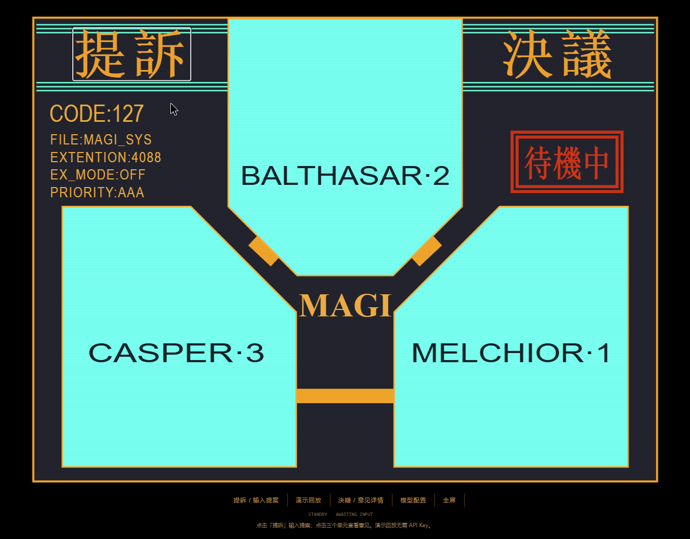

# MAGI Council

三个独立视角。一次有限讨论。看见共识，也保留反对票。

受 EVA MAGI 启发的非官方开源实验。主屏按经典「提訴／決議」画面重绘：上方 BALTHASAR、左下 CASPER、右下 MELCHIOR，青色多边形与橙色连接线。输入、模型配置和意见详情收进弹窗。不含原作截图、音轨或语音功能。



[无声操作演示](output/playwright/magi-classic.webm) · [验证记录](docs/VALIDATION.md) · [发布文案](docs/LAUNCH.md)

开发预览版：程序与模拟 Provider 通路已验证；真实模型效果仍需自备 Key 验收。可选 [Harness 工具适配](docs/HARNESS.md) 已实现，尚未完成宿主完整生命周期验收。

## 启动

需要 Node.js 24 或以上，无第三方运行时依赖。

```sh
npm start
```

打开 http://127.0.0.1:3088。点击“演示回放”无需 API Key；回放是固定脚本，不会分析自定义问题。

主屏点击「提訴」输入提案，点击「決議」或任意单元打开意见详情。底部操作栏提供演示回放、模型配置与全屏；单元颜色随真实投票更新，回放始终标记 DEMO。

### 第一次真实使用

1. 点击底部「模型配置」。若使用 DeepSeek，Base URL 为 `https://api.deepseek.com`，模型 ID 为 `deepseek-flash`；在第一组 MELCHIOR 填入你自己的 API Key。
2. 点击「将第一组配置复制到三个单元」，再点「保存配置」。也可以为三个单元分别配置不同模型。
3. 点击「提訴」，输入明确提案，点击「确认提案并启动」。完成后点击单元或「決議」查看详细理由。

没有 Key 时可先用「演示回放」，它不会分析自定义问题。未配置 Key 时启动会在提案窗口直接提示，并提供配置入口；从这里保存完整配置后会自动回到原提案。Key 只填在本机页面，不需要发到聊天里。

默认模型依据 [DeepSeek 官方接入文档](https://api-docs.deepseek.com/) 于 2026-11-04 更新。官方 DeepSeek 接口使用非思考模式返回短判断，避免短输出预算被长推理占满；其他兼容接口不附加此专用参数。模型鉴权、余额或地址错误会给出对应提示。

真实运行：在“模型配置”中为三个单元填写 Chat Completions 兼容 API 地址、模型名称和 Key。也可以将 `.env.example` 复制为 `.env` 填写默认配置。DeepSeek 默认地址是 `https://api.deepseek.com`；其他兼容服务通常需要 `/v1` 前缀。服务会追加 `/chat/completions`。

界面保存的 Key 仅在本机服务内存中存在，重启丢失；`.env` 可提供持久默认值，已被 Git 忽略。无 Key 的配置导入导出、原生非兼容协议尚未实现。连接测试会产生一次模型调用。

## 协作规则

- MELCHIOR：证据、逻辑、可行性。
- BALTHASAR：相关人的利益、风险、长期影响。
- CASPER：意愿、自主、价值取向。

用户确认一个可以赞成或反对的提案。三个单元首轮上下文独立；首轮均成功后，各自阅读三份意见并直接给出终票。两轮最多六次模型调用，不自动重试。单次请求最多 60 秒，一次运行最多 180 秒。支持中止，不保证服务商停止已产生的计费。

多数决至少两票通过或否决；全票模式只有三票赞成通过，有反对票否决，其余暂缓。任何单元故障都不产生正式裁决。投票由程序计算，无第四个模型裁决。当前模型调用是非流式回复，界面实时显示阶段事件。未提供联网检索。

## 验证

```sh
npm test
```

覆盖全部投票组合、首轮隔离、故障与取消。真实模型效果需用户自备 Key 验证，不以回放替代真实验收。

浏览器首次使用回归函数位于 `tools/verify-onboarding.js`，可通过 Playwright CLI 的 `run-code` 执行。它拦截配置和运行接口，用虚构密钥检查缺少配置、复制、保存返回、失败提示和回放，不保存真实配置或产生模型费用。

## 部署与局限

仅绑定 `127.0.0.1`，限制 Host 和 Origin。面向个人本机使用，不应直接通过反向代理公开；公网部署还需要身份认证、限流、目标地址限制等。用户配置的 Base URL 会收到用户问题与 Key。

当前没有会话持久化、断线恢复、token 价格换算、任意问题自动整理提案。界面运行记录仅在页面内存中，刷新丢失，请及时导出 Markdown。多个页面可并发调用，各自承担调用费用。

## English

An unofficial EVA-inspired three-perspective AI deliberation terminal. Run `npm start` with Node 24+, open localhost:3088, and try the explicitly labeled scripted demo. For real deliberation, configure three Chat Completions-compatible model connections. Two isolated/review rounds, deterministic voting, cancellation, and Markdown export. No voice. No claim that consensus implies correctness.

## 素材与许可

代码采用 MIT，详见 LICENSE。界面由 HTML/CSS 原创绘制，使用系统字体。项目不附带 EVA 图片、标志、音乐或声优素材。原作角色和名称属于各自权利人。本项目人格职责和投票规则为产品改编。
